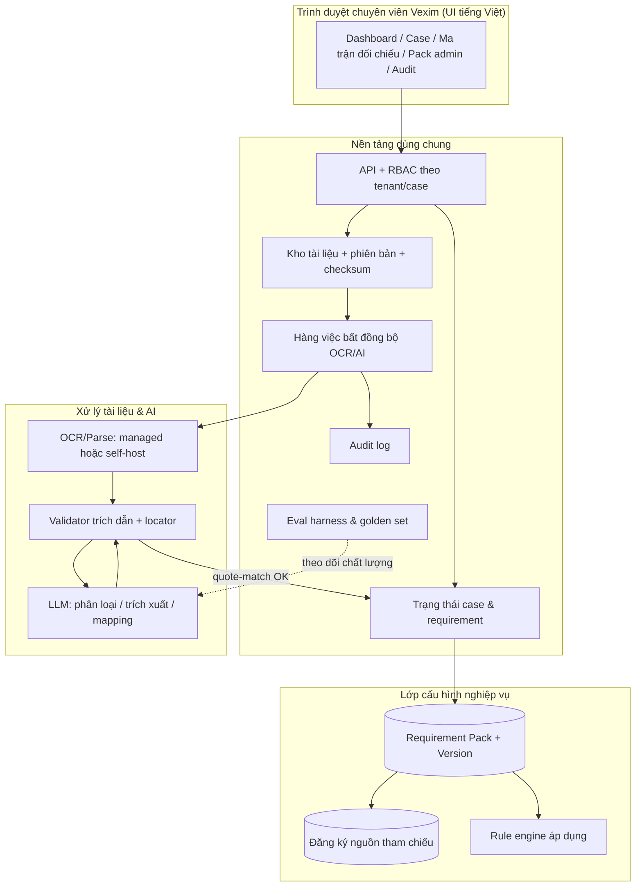

# Báo cáo nghiên cứu tính khả thi
## Nền tảng AI hỗ trợ rà soát hồ sơ đa sản phẩm cho Vexim

| Mục | Giá trị |
| --- | --- |
| Ngày lập | 11/10/2026 |
| Đối tượng đánh giá | Đặc tả sản phẩm & kỹ thuật v1.0 (do Vexim cung cấp) |
| Phạm vi đánh giá | Khả thi nghiệp vụ, kỹ thuật, dữ liệu, pháp lý/tuân thủ, kinh tế, vận hành |
| Trạng thái tài liệu | **Đánh giá sơ bộ phục vụ ước lượng & thiết kế.** Mọi nội dung quy định phải được Vexim/chuyên gia xác minh trước khi dùng làm căn cứ nghiệp vụ |
| Nguồn | Tài liệu công khai (GACC, cơ quan nhà nước VN, USDA GAIN, nghiên cứu học thuật) — xem Phụ lục D |

> ⚠️ Tài liệu này **không** phải là tư vấn pháp lý. Các nội dung về Lệnh 280/248, Luật AI, Luật Bảo vệ dữ liệu cá nhân cần được Vexim đối chiếu với văn bản gốc và/hoặc ý kiến luật sư trước khi quyết định.

---

## 0. Cách đọc báo cáo: phân loại độ tin cậy nguồn

| Loại | Mô tả | Cách dùng |
| --- | --- | --- |
| **A — Chính thức** | GACC, Chính phủ/Bộ ngành VN, USDA GAIN (bản dịch chính thức văn bản GACC) | Được dùng làm *căn cứ nguồn* cho requirement pack |
| **B — Chuyên trang pháp lý/tư vấn uy tín** | China Briefing, CIRS, HLC, LNT & Partners, Vietnam Briefing, EY | Định hướng, đối chiếu chéo; cần quay về nguồn A trước khi publish |
| **C — Blog thương mại/tổng hợp** | Các blog dịch vụ GACC, blog tổng hợp giá, blog SEO | **Chỉ dùng để phát hiện tín hiệu**, tuyệt đối không làm nguồn chuẩn của pack |

Một phát hiện đáng chú ý ngay trong quá trình nghiên cứu (xem mục 2.3): **các nguồn loại B/C mâu thuẫn với nhau về chính danh sách 17 nhóm hàng**. Điều này không phải chi tiết vụn vặt — nó là bằng chứng trực tiếp ủng hộ nguyên tắc "mọi requirement phải có nguồn + phiên bản + người duyệt" trong đặc tả.

---

## 1. Tóm tắt điều hành

### 1.1 Kết luận

> **Dự án KHẢ THI CÓ ĐIỀU KIỆN — điểm tổng hợp ~6,5–7/10.**
> Công nghệ cần có đã sẵn sàng và chi phí biến đổi (OCR/LLM) rất nhỏ so với chi phí nhân sự. Rủi ro lớn nhất **không nằm ở AI** mà nằm ở (1) nội dung quy định đang thay đổi, (2) chất lượng bản scan thực tế tại VN, và (3) việc thiếu một chủ sở hữu nội dung (content owner) và quy trình duyệt pack bên phía Vexim.

**Không nên** tiến hành xây full MVP ngay theo đặc tả hiện tại. Nên làm theo 3 bước:

1. **Giai đoạn 0 (2–4 tuần, bắt buộc):** chốt nội dung theo khung pháp lý *hiện hành* và đo chất lượng AI thực tế trên bộ hồ sơ thật/đã ẩn danh.
2. **MVP hẹp (12–16 tuần):** 1 pack đã duyệt, không cổng khách hàng, chỉ export Excel + PDF, tối đa 3–5 người dùng nội bộ.
3. **Mở rộng (sau khi vượt ngưỡng chất lượng):** thêm pack/thị trường, cổng khách hàng, tự động hóa.

### 1.2 Năm phát hiện làm thay đổi giả định của đặc tả

| # | Phát hiện | Hệ quả với đặc tả |
| --- | --- | --- |
| **F1** | **Lệnh 248 đã hết hiệu lực.** Lệnh 280 (ban hành 14/10/2025) có hiệu lực từ **1/6/2026**; Thông báo 27/2026 thu hẹp danh mục từ 18 → **17 nhóm**; Thông báo 219/2025 điều chỉnh nhóm nông sản sơ cấp. Đăng ký **tự động gia hạn 5 năm** (trừ thịt & yến). Doanh nghiệp **tự nộp** sau khi có báo cáo kiểm tra + thư giới thiệu của cơ quan thẩm quyền | Bất kỳ checklist/pack nào xây trên Lệnh 248 (kể cả biểu mẫu "người dùng cung cấp") đều **đã lỗi thời**. Pack đầu tiên phải biên soạn lại từ đầu |
| **F2** | **Danh mục là "động"**, không cố định: với gạo, nhóm "ngũ cốc dùng làm thực phẩm" được điều chỉnh thành **"nhóm gạo"**; yếu tố rủi ro gồm sinh vật gây hại, an toàn thực phẩm, **dư lượng cadimi**, **gạo biến đổi gen** | Khẳng định hướng "đa sản phẩm + điều kiện áp dụng" của đặc tả là đúng; đồng thời nghĩa là **pack phải có cơ chế cảnh báo khi danh mục thay đổi**, không chỉ "ngày xem xét lại" |
| **F3** | Nguồn thứ cấp mâu thuẫn về chính danh mục 17 nhóm; các "checklist GACC" trôi nổi trên mạng phần lớn viết theo Lệnh 248 | Cần **Đăng ký nguồn tham chiếu** (registry) bắt buộc + phân loại nguồn + ngày truy cập; nghiêm cấm lấy blog làm căn cứ pack |
| **F4** | **Luật AI 134/2025/QH15** (hiệu lực 1/3/2026) + **NĐ 142/2026/NĐ-CP** (1/5/2026): bắt buộc **phân loại rủi ro trước khi đưa vào vận hành**, ghi nhãn nội dung do AI tạo, quy trình báo cáo sự cố. **QĐ 33/2026/QĐ-TTg** (hiệu lực 15/8/2026) công bố **46 hệ thống AI rủi ro cao** trong 6 lĩnh vực (giáo dục, dân tộc–tôn giáo, y tế, ngân hàng, tố tụng, giao thông) — **không có** rà soát hồ sơ XNK | Nền tảng nhiều khả năng rơi vào **rủi ro trung bình** (đầu ra AI có thể gây nhầm lẫn) → nghĩa vụ: hồ sơ phân loại rủi ro, thông báo qua Cổng một cửa AI, **ghi nhãn rõ kết quả do AI sinh ra**, báo cáo sự cố. Thiết kế "AI chỉ gợi ý, chuyên viên quyết" trong đặc tả là lợi thế tuân thủ — cần giữ nguyên và ghi nhận thành chứng cứ |
| **F5** | **Luật BVDLCN 91/2025/QH15** + **NĐ 356/2025/NĐ-CP** (hiệu lực 1/1/2026): DPIA/CTIA, chuyển dữ liệu cá nhân ra nước ngoài phải đánh giá tác động; NĐ 53/2022 còn hiệu lực về lưu trữ dữ liệu | Nếu dùng **LLM API nước ngoài** để xử lý hồ sơ có dữ liệu cá nhân (người đại diện, người liên hệ, chữ ký, CCCD…), Vexim phải có đánh giá chuyển dữ liệu ra nước ngoài và điều khoản xử lý dữ liệu với nhà cung cấp. Đây là **điều kiện tiên quyết**, không phải việc để sau |

### 1.3 Điểm khả thi theo trục

| Trục | Điểm | Lý do chính |
| --- | --- | --- |
| Nghiệp vụ & quy định | **5/10** | Khung pháp lý vừa đổi (F1, F2); Vexim chưa có pack đã duyệt; thiếu chủ sở hữu nội dung |
| Quy trình & người dùng | **8/10** | Luồng A–D rõ ràng, human-in-the-loop đúng hướng, phân vai hợp lý |
| Dữ liệu & tài liệu | **6/10** | Đa ngôn ngữ (VN/EN/ZH) + scan chất lượng thấp; OCR tiếng Việt đạt ~82–87% ở mức tốt (xem 4.2) |
| Kỹ thuật AI | **7/10** | Tech sẵn có; rủi ro chính là trích dẫn bịa → **có chốt kiểm soát kỹ thuật bắt buộc** (4.3) |
| Pháp lý/tuân thủ (AI & dữ liệu) | **6/10** | Nghĩa vụ mới, cần làm trước go-live; không cấm triển khai |
| Bảo mật & đa tenant | **8/10** | Yêu cầu chuẩn, đã được đặc tả bao phủ tốt |
| Kinh tế | **7/10** | OPEX AI rất thấp (vài USD/case); CAPEX 34–52 person-month; business case cần dữ liệu thực của Vexim |
| Vận hành & tổ chức | **5/10** | **Nút thắt thật sự**: ai biên soạn/duyệt pack, ai chịu trách nhiệm khi pack sai, nhịp rà soát |
| Tích hợp | **9/10** | MVP không tích hợp → rủi ro thấp |

---

## 2. Các phát hiện chi tiết

### 2.1 Khung pháp lý nguồn đã thay đổi (Lệnh 248 → Lệnh 280)

| Tiêu chí | Lệnh 248 | Lệnh 280 (hiện hành từ 1/6/2026) |
| --- | --- | --- |
| Hiệu lực | 1/1/2022 | **1/6/2026** (thay thế 248) |
| Cách xác định nhóm phải "đề xuất chính thức" | Danh sách cố định **18 nhóm** | **Danh mục động**, hiện còn **17 nhóm** |
| Điều kiện hệ thống | Yêu cầu hệ thống ATTP nước xuất khẩu vượt đánh giá tương đương | **Bỏ** yêu cầu này |
| Cơ chế mới | – | **"Đăng ký theo danh sách"** cho nước có thỏa thuận hợp tác ATTP được GACC công nhận |
| Gia hạn | Doanh nghiệp chủ động xin gia hạn 3–6 tháng trước hạn | **Tự động gia hạn 5 năm**, trừ trường hợp bị loại (thịt & sản phẩm thịt, yến) |
| Nộp hồ sơ | Cơ quan thẩm quyền nộp thay | Doanh nghiệp **tự nộp trên CIFER** sau khi có báo cáo kiểm tra & thư giới thiệu của cơ quan thẩm quyền |
| Kho lạnh | Chưa rõ | Đưa **kho lạnh bảo quản sản phẩm động vật trên cạn & thủy sản** vào diện đăng ký |
| Hiệu lực mã | 5 năm | 5 năm, tự gia hạn |
| Thay đổi danh mục | – | **Quản lý động**; nhóm bị đưa ra khỏi danh mục chuyển sang Thông báo 219/2025 |

Nguồn: [4](https://www.zmuni.com/en/news/chinaissuesnewgaccregulationonregistrationofoverseasfoodmanu/) (so sánh 248/280), [1](https://apps.fas.usda.gov/newgainapi/api/Report/DownloadReportByFileName?fileName=GACC+Issues+Decree+280+Implementation+Guidance_Beijing_China+-+People%27s+Republic+of_CH2026-0034.pdf) (danh mục 17 nhóm, ngoại lệ tự gia hạn), [2](https://www.china-briefing.com/news/gac-overseas-food-manufacturer-registration-china-new-rules-2026/) (doanh nghiệp tự nộp sau khi có báo cáo kiểm tra + thư giới thiệu), [1](https://english.shanghai.gov.cn/en-PolicyInsights/20260520/107a02b4edc2431687cfe796d1d0c223.html) (18 → 17, nhóm bị loại chuyển sang Thông báo 219/2025, CIFER là kênh duy nhất, không thu phí), [2](https://chicucttbvtvhcm.gov.vn/hoat-dong-don-vi/thong-tin-quy-dinh-va-huong-dan-tai-lenh-280-nghi-dinh-280-va-thong-bao-219-cua-tong-cuc-hai-quan-trung-quoc-gacc-z-1741.html) (hướng dẫn của cơ quan chuyên môn VN).

**Danh mục 17 nhóm (theo hướng dẫn 2026):** thịt & sản phẩm thịt; ruột gia súc làm vỏ xúc xích; tổ yến; sản phẩm ong mật; trứng & sản phẩm trứng; dầu mỡ ăn được; sản phẩm bánh có nhân; **ngũ cốc dùng làm thực phẩm**; sản phẩm xay xát ngũ cốc & mạch nha; rau sấy khô; bột gia vị; hạt các loại; trái cây khô; thực phẩm ăn kiêng đặc biệt; thực phẩm chức năng; sữa & sản phẩm sữa; thủy sản — và danh mục này **chịu quản lý động** [1](https://apps.fas.usda.gov/newgainapi/api/Report/DownloadReportByFileName?fileName=GACC+Issues+Decree+280+Implementation+Guidance_Beijing_China+-+People%27s+Republic+of_CH2026-0034.pdf), [1](https://english.shanghai.gov.cn/en-PolicyInsights/20260520/107a02b4edc2431687cfe796d1d0c223.html).

### 2.2 Riêng nhóm gạo/ngũ cốc: yêu cầu bị tinh chỉnh theo sản phẩm

Theo thông tin từ Cục Xuất nhập khẩu (Bộ Công Thương) được báo chí dẫn lại, với sản phẩm **gạo**, danh mục "ngũ cốc dùng làm thực phẩm" đã được điều chỉnh thành **"nhóm gạo"**, và tài liệu đánh giá rủi ro được xem xét trên cơ sở: mức độ rủi ro ATTP, tỷ lệ lô hàng nhập khẩu không đạt, lịch sử sự cố, nguy cơ nhiễm sinh vật gây hại, **dư lượng kim loại nặng (cadimi)**, **gạo biến đổi gen** [4](https://www.tinnhanhchungkhoan.vn/xuat-khau-nong-san-sang-trung-quoc-tu-16-luu-y-lenh-280-post391047.html).

**Hệ quả thiết kế (ủng hộ mạnh thiết kế của đặc tả):**
- Requirement **phải có `applicability_rule`** gắn với thuộc tính case (nhóm hàng = gạo/ngô/đậu…; công đoạn; có sấy/hun trùng/kho lạnh…).
- Với cùng "ngũ cốc", requirement của **gạo** ≠ requirement của **ngô/đậu** (cadimi, GMO, sinh vật gây hại là ví dụ điển hình).
- Cần một **bộ thuộc tính bắt buộc phải khai trước khi hệ thống kết luận phạm vi áp dụng**, nếu thiếu → trạng thái `Cần làm rõ` (đúng như mục 7.1).

### 2.3 Nguồn thứ cấp mâu thuẫn → minh chứng cho việc phải có quản trị nội dung

Trong cùng một thời điểm, các nguồn B/C đưa ra **danh sách 17 nhóm không giống nhau** (ví dụ: một số nguồn còn liệt kê "cà phê/cacao chưa rang" vốn đã bị loại khỏi danh mục theo nguồn chính thức [1](https://english.shanghai.gov.cn/en-PolicyInsights/20260520/107a02b4edc2431687cfe796d1d0c223.html), [3](https://appinchina.co/blog/how-can-i-obtain-chinas-gacc-registration/)). Cũng có sự khác biệt giữa bản thảo tháng 1/2025 (còn đề xuất 11 nhóm) và văn bản cuối cùng [4](https://www.cirs-group.com/en/food/good-news-for-gacc-registration-health-foods-and-special-dietary-foods-may-no-longer-require-official-recommendation-for-registration).

→ **Khuyến nghị thiết kế:** mỗi requirement lưu `source_ref` trỏ tới một bản ghi trong **Đăng ký nguồn tham chiếu** (Phụ lục D) với: loại nguồn (A/B/C), trích yếu văn bản, điều/khoản, URL, ngày truy cập, người xác minh. Với requirement chưa có nguồn A/B → bắt buộc gắn nhãn `quy_trình_nội_bộ/chờ xác minh` như đặc tả đã nêu.

### 2.4 Luồng thực tế phía Việt Nam: hai bước, không phải một

- Doanh nghiệp **tự đăng ký trên CIFER** với nhóm không thuộc danh mục; với nhóm **thuộc danh mục**: phải được **cơ quan có thẩm quyền VN kiểm tra, xác nhận và giới thiệu** trước, rồi doanh nghiệp nộp [2](https://chicucttbvtvhcm.gov.vn/hoat-dong-don-vi/thong-tin-quy-dinh-va-huong-dan-tai-lenh-280-nghi-dinh-280-va-thong-bao-219-cua-tong-cuc-hai-quan-trung-quoc-gacc-z-1741.html).
- Dữ liệu đăng ký phải nhất quán và duy trì: tên doanh nghiệp, địa chỉ cơ sở, người đại diện pháp luật, người liên hệ, mã đăng ký do cơ quan VN cấp, nhóm sản phẩm; mã đăng ký phải thể hiện trên bao bì/nhãn và được importer khai đúng trên tờ khai [3](https://honganhlogs.com/lenh-280-gacc-doanh-nghiep-rau-qua-viet-nam-2026/).
- Các cơ quan thẩm quyền VN theo nhóm hàng (nguồn loại C — **cần Vexim xác minh bằng văn bản chính thức**): Cục Trồng trọt & BVTV (nguồn gốc thực vật, gồm ngũ cốc), Cục Thú y (động vật), Cục Quản lý chất lượng NLS & TS, Cục ATTP (Bộ Y tế), Vụ KH&CN (Bộ Công Thương) [1](https://chungnhanquocgia.com/gacc-la-gi/).

→ **Cơ hội giá trị gia tăng cho nền tảng:** kiểm tra **tính nhất quán chéo** giữa các tài liệu (tên pháp lý/địa chỉ/người đại diện trên GPKD vs. chứng chỉ HACCP vs. đơn đăng ký) — đây là lỗi phổ biến, dễ tự động hóa, và **không cần diễn giải pháp lý** (chỉ so khớp chuỗi). Nên đưa vào MVP như một loại "phát hiện" riêng (mục 6: `conflicts`).

### 2.5 Tuân thủ tại Việt Nam: Luật AI & dữ liệu cá nhân

**Luật Trí tuệ nhân tạo 134/2025/QH15** (hiệu lực 1/3/2026) + **NĐ 142/2026/NĐ-CP** (1/5/2026):
- Bắt buộc **phân loại hệ thống AI theo 3 mức rủi ro trước khi đưa vào vận hành**; lập hồ sơ phân loại cho mức trung bình & cao [3](https://www.aplawjapan.com/en/newsletter/20260528-2), [1](https://vietanlaw.com/decree-142-2026-nd-cp-guiding-the-artificial-intelligence-law-in-vietnam/).
- Mức **trung bình**: hệ thống không thuộc danh mục rủi ro cao **và** có khả năng gây nhầm lẫn vì người dùng không nhận biết đang tương tác với AI/nội dung do AI tạo. Nghĩa vụ chính: **minh bạt/ghi nhãn**, thông báo qua Cổng một cửa AI [3](https://www.aplawjapan.com/en/newsletter/20260528-2).
- **QĐ 33/2026/QĐ-TTg** (hiệu lực 15/8/2026): **46 hệ thống AI rủi ro cao** thuộc 6 lĩnh vực: giáo dục, dân tộc & tôn giáo, y tế, ngân hàng, tố tụng, giao thông vận tải [2](https://www.hlc.com/en/publications/vietnam-designates-highrisk-ai-systems-what-businesses-need-to-know), [5](https://mst.gov.vn/46-he-thong-ai-duoc-xep-vao-nhom-rui-ro-cao-phai-quan-ly-nghiem-ngat-197260703152945179.htm). **Rà soát hồ sơ XNK không nằm trong danh mục này.**
- Nghĩa vụ báo cáo sự cố nghiêm trọng (thời hạn ngắn, theo NĐ 142) và mức phạt tối đa tới VNĐ 2 tỷ + tỷ lệ % doanh thu với vi phạm nghiêm trọng [3](https://digitalinasia.com/vietnam-ai-law-explained/).

**Đánh giá cho nền tảng này:** khả năng cao thuộc **rủi ro trung bình** (kết quả phân loại/trích xuất/đề xuất trạng thái do AI sinh ra, người dùng có thể nhầm với kết luận của chuyên viên). Ba việc cần làm trước go-live:
1. Lập **hồ sơ phân loại rủi ro** (self-assessment) có lưu vết; nhờ MOST hướng dẫn nếu chưa rõ.
2. **Ghi nhãn rõ ràng** mọi đầu ra AI trong UI & báo cáo export (đặc tả đã có disclaimer — cần nâng thành nhãn ở cấp từng trường/đề xuất, không chỉ cuối báo cáo).
3. Có quy trình **báo cáo sự cố** (khi AI đưa ra kết luận sai nghiêm trọng bị phát hiện sau khi đã gửi khách).

**Luật Bảo vệ dữ liệu cá nhân 91/2025/QH15** + **NĐ 356/2025/NĐ-CP** (hiệu lực 1/1/2026):
- Nghĩa vụ **DPIA** (đánh giá tác động xử lý) và **CTIA** (đánh giá tác động chuyển dữ liệu ra nước ngoài), nộp trong 60 ngày; một số trường hợp miễn (cơ quan nhà nước; lưu dữ liệu nhân viên trên cloud; chính chủ thể tự chuyển…) [1](https://www.vietnam-briefing.com/doing-business-guide/vietnam/company-establishment/vietnam-personal-data-privacy-law), [3](https://english.luatvietnam.vn/legal-updates/the-latest-law-on-personal-data-protection-and-the-guiding-documents-892-106778-article.html).
- NĐ 356/2025 có hướng dẫn riêng về bảo vệ dữ liệu cá nhân **trong hệ thống AI và metaverse** [3](https://english.luatvietnam.vn/legal-updates/the-latest-law-on-personal-data-protection-and-the-guiding-documents-892-106778-article.html).
- Lưu trữ dữ liệu: **NĐ 53/2022/NĐ-CP** vẫn còn hiệu lực song song, yêu cầu lưu trữ tại VN với nhóm dịch vụ bị áp dụng; mức phạt vi phạm chuyển dữ liệu xuyên biên giới có thể tới **5% doanh thu năm trước** [4](https://www.recordinglaw.com/world-laws/world-data-privacy-laws/vietnam-data-privacy-laws/).

→ **Quyết định kỹ thuật bị chi phối trực tiếp:** phương án "dùng LLM API nước ngoài" (đơn giản nhất) chỉ hợp lệ sau khi Vexim có (i) điều khoản xử lý dữ liệu/không dùng để huấn luyện với nhà cung cấp, (ii) đánh giá chuyển dữ liệu ra nước ngoài, (iii) chính sách ẩn danh/giảm thiểu dữ liệu trước khi gửi (xem 4.4).

---

## 3. Khả thi nghiệp vụ: pack đầu tiên

### 3.1 Đánh giá thiết kế "nền tảng dùng chung + lớp cấu hình"

Đặc tả chọn đúng (**không** hard-code "gạo"; pack theo thị trường × chương trình × nhóm hàng × loại cơ sở × phiên bản). Đây là quyết định thiết kế quan trọng nhất và **khả thi**, với 3 điều kiện:

1. **Rule engine cho `applicability_rule` phải đơn giản và kiểm thử được.** Khuyến nghị bắt đầu với tập toán tử hạn chế (`IN`, `EQUALS`, `AND/OR/NOT`, `IS_KNOWN`, `IS_UNKNOWN`) trên các thuộc tính case có kiểu rõ ràng (enum/số/ngày/bool). Tránh DSL tự do trong MVP.
2. **Kết quả đánh giá rule phải giải thích được:** lưu lại `rule_id`, đầu vào, kết quả trung gian để UI trả lời "vì sao requirement này áp dụng/không áp dụng" (FR-02). Nếu không lưu, tính truy vết bị mất.
3. **Thiếu thông tin đầu vào ⇒ `Cần làm rõ`, không được suy luận.** Phải là quy tắc bất biến có unit test.

### 3.2 Ước lượng biên soạn pack đầu tiên

| Hạng mục | Ước lượng | Ghi chú |
| --- | --- | --- |
| Số requirement trong pack ngũ cốc/TQ | **60–150** mục (sau khi tách: cơ sở / nhà xưởng–quy trình / nguyên liệu–nhà cung cấp / sản phẩm / lô hàng / có điều kiện) | Con số thật do chuyên gia Vexim chốt |
| Thời gian biên soạn | 5–8 ngày công BA/nghiên cứu viên + 3–5 ngày công chuyên gia | Chưa gồm dịch thuật |
| Kiểm chứng nguồn & duyệt | 2–3 ngày công chuyên gia + 1 ngày quản lý | Bắt buộc trước publish |
| Nhập vào hệ thống (nếu chưa có UI admin) | 1–2 ngày công | Có thể import từ CSV/YAML |
| **Tổng** | **~2–3 tuần lịch (có người phụ trách rõ ràng)** | Vòng lặp lại cho mỗi pack mới: ~1–2 tuần |

**Lưu ý:** nỗ lực biên soạn pack ~ **5–10%** tổng nỗ lực dự án, nhưng **rủi ro sai nội dung chiếm >50%** tổng rủi ro nghiệp vụ. Đây là lý do cần một vai trò "Quản trị nội dung quy định" thật (không phải làm thêm).

### 3.3 Các quyết định nghiệp vụ còn bỏ ngỏ (xem Phụ lục A để có câu trả lời đề xuất)

Đặc tả có 12 câu hỏi (mục 16). Trong đó **5 câu quyết định phạm vi MVP** (1, 3, 4, 6, 11) và **3 câu quyết định kiến trúc dữ liệu** (3, 4, 10). Chưa có đáp án thì dev **không thể báo giá chắc chắn**, chỉ có thể báo giá theo kịch bản.

---

## 4. Khả thi kỹ thuật

### 4.1 Pipeline: điểm gãy nằm ở đâu

```
Tải file → kiểm tra định dạng/MIME/dung lượng → lưu bản gốc + checksum
  → [R1] TRÍCH XUẤT TEXT / OCR  ← rủi ro cao nhất với scan VN/ZH
  → [R2] phân đoạn + page locator ← bắt buộc cho mọi trích dẫn
  → phân loại tài liệu
  → trích xuất trường
  → [R3] tìm evidence theo requirement ← rủi ro trích dẫn bịa
  → [R4] KIỂM TRA TRÍCH DẪN (quote-match) ← chốt chặn cứng
  → hiển thị để chuyên viên duyệt → lưu quyết định + audit
```

| Rủi ro kỹ thuật | Mức | Biện pháp bắt buộc |
| --- | --- | --- |
| **R1 OCR kém** (scan nghiêng, mờ, dấu tiếng Việt, song ngữ VN–ZH) | Cao | Đo chất lượng OCR/trang; ngưỡng thấp ⇒ trạng thái `cần xử lý thủ công`, **không tự điền**; lưu ảnh crop cạnh văn bản để chuyên viên đối chiếu |
| **R2 mất locator** | TB | Mọi đoạn text phải có `{page, bbox hoặc span offset}`; không có locator ⇒ không được lưu thành evidence |
| **R3 trích dẫn/đề xuất sai** | Cao | Prompt yêu cầu trích nguyên văn + validator bắt buộc (4.3) |
| **R4 vượt ngưỡng trích dẫn hợp lệ** | Cao | Nếu tỷ lệ quote không khớp > ngưỡng ⇒ chặn publish kết quả cho case đó |

### 4.2 Bằng chứng về chất lượng OCR đa ngôn ngữ (VN/EN/ZH)

- Mô hình OCR đa ngôn ngữ nhỏ gọn (PaddleOCR-VL, ~0,9B tham số) đạt chất lượng cao trên văn bản in tiếng Trung và nhiều kịch bản khó (chữ viết tay, chữ cổ, bảng biểu) [4](https://arxiv.org/html/2510.14528v1).
- Với **tiếng Việt**, mô hình chuyên biệt hóa gần đây đạt **~82,8 điểm tổng hợp tài liệu tiếng Việt** và **~86,7% nhận dạng văn bản tiếng Việt**, chỉ nhỉnh hơn mô hình cơ sở nhưng vẫn **kém đáng kể so với tiếng Trung/Anh** [1](https://www.vietalpha.org/research/senocr-vi).
- Ngay cả mô hình tốt nhất trong các benchmark công bố vẫn ở mức **80–87**, tức **cứ 6–8 trang scan có thể có 1 trang lỗi đáng kể** trong điều kiện thực tế (mờ, nghiêng, con dấu đè chữ).

**Hệ quả:** OCR **không phải** phần có thể "set and forget". Cần: (i) đo chất lượng theo case/tháng, (ii) cơ chế `needs OCR` + xử lý thủ công, (iii) ưu tiên UI xem song song bản scan ↔ text (FR-05) — đây là tính năng **bắt buộc**, không phải "nice to have".

### 4.3 Rủi ro trích dẫn bịa — và chốt kiểm soát bắt buộc

Bằng chứng thực nghiệm:
- Ngay cả hệ thống **có RAG/truy xuất** vẫn tạo ra **3–13% URL trích dẫn bịa**, 5–18% liên kết không truy cập được; có tới **~57% trích dẫn bị "hợp lý hóa sau"** (sinh từ trí nhớ mô hình rồi mới gắn nguồn) [2](https://arxiv.org/pdf/2604.03173).
- Benchmark quy mô lớn (GhostCite): tỷ lệ trích dẫn bịa từ **14,23% đến 94,93%** tùy mô hình & lĩnh vực; **không mô hình nào đạt 0%**; ước tính **50–90% trích dẫn không thực sự hỗ trợ khẳng định** được gắn [5](https://mentionova.com/blog/llm-citation-statistics).

→ **Hệ quả thiết kế (nâng từ "nên" thành "bắt buộc", cập nhật mục 10 của đặc tả):**

| Chốt kiểm soát | Mô tả | Hành vi khi vi phạm |
| --- | --- | --- |
| **C1 — Quote-match gate** | Kiểm tra chuỗi máy: đoạn trích AI đưa ra **phải xuất hiện** trong text của đúng `page/locator` (sau chuẩn hóa khoảng trắng/dấu; cho phép fuzzy nhẹ) | Không khớp ⇒ **hủy** evidence, ghi `invalid_citation`, không hiển thị như bằng chứng |
| **C2 — Locator bắt buộc** | Mọi evidence có `document_version + page + span/bbox` | Thiếu ⇒ không được tạo evidence |
| **C3 — Không tự duyệt** | AI chỉ được gán 4 đề xuất (có bằng chứng tiềm năng / chưa tìm thấy / có thể không áp dụng / cần người rà soát) | Bất kỳ đường dẫn nào tự chuyển sang `Đã rà soát nội bộ` ⇒ chặn ở mức ứng dụng + test bất biến |
| **C4 — Không tự điền giá trị** | Thiếu số liệu/ngày ⇒ `unknowns`, không nội suy | Phát hiện qua bộ test "trường rỗng" |
| **C5 — Ghi nhãn nguồn gốc** | Mọi ô dữ liệu hiển thị nhãn: `AI đề xuất` / `Chuyên viên xác nhận` / `Sửa tay` | Bắt buộc trong UI & export (cũng phục vụ Luật AI) |
| **C6 — Confidence ≠ tuân thủ** | Không hiển thị % tuân thủ; confidence chỉ là độ tin cậy trích xuất | Kiểm tra khi review UI/export |

Gợi ý bổ sung kỹ thuật: lưu cùng lúc `quote` và `char_start/char_end` trên text đã chuẩn hoá; khi hiển thị, highlight trực tiếp trên text và ảnh trang — giúp chuyên viên kiểm trong 2–3 giây thay vì đọc lại tài liệu.

### 4.4 Kiến trúc đề xuất & các phương án công nghệ



Ba phương án (khuyến nghị **B** cho MVP):

| | **A — Managed toàn phần** | **B — Hybrid (khuyến nghị)** | **C — Self-host nhiều nhất** |
| --- | --- | --- | --- |
| OCR | Azure DI / Google DAI / Textract | Tự host (PaddleOCR-VL/MinerU-class) hoặc managed tùy loại file | Tự host |
| LLM | API nước ngoài | API nước ngoài **có DPA + tối giản dữ liệu**, hoặc model trong khu vực | Model mở, tự host GPU |
| Ưu | Nhanh nhất, ít vận hành | **Cân bằng tốc độ & chủ quyền dữ liệu**; OCR/scan nhạy cảm giữ tại chỗ | Tối đa kiểm soát dữ liệu |
| Nhược | Dữ liệu hồ sơ ra nước ngoài ngay từ khâu OCR | Vận hành 2 phần | Chậm, cần đội ML ops; chất lượng có thể thấp hơn frontier |
| Phù hợp khi | Vexim đã chấp thuận DPA & CTIA đầy đủ | **Kịch bản mặc định** | Vexim có yêu cầu nội bộ bắt buộc lưu dữ liệu tại chỗ |

**Về chi phí OCR (tham chiếu thị trường, 2026):** OCR thô ~**1,50 USD/1.000 trang** (Azure/Google/AWS ngang nhau); phân tích layout/khối ~10 USD/1.000 trang; trích xuất tuỳ biến ~30 USD/1.000 trang; một số API mới hơn chào ~2 USD/1.000 trang (1 USD ở chế độ batch); Google tính thêm phí "để processor chạy" theo giờ [1](https://docuocr.com/blog/azure-document-intelligence-pricing), [2](https://aiproductivity.ai/blog/document-ai-cost-comparison/). Chênh lệch giữa các nhà cung cấp **không đáng kể** so với chi phí nhân sự — tiêu chí chọn nên là **độ chính xác trên chính bộ hồ sơ của Vexim**, không phải giá.

**Về chi phí LLM:** giá phổ biến khoảng **0,2–5 USD/1M token đầu vào** và **1,2–25 USD/1M token đầu ra** tùy hạng mô hình; giá thay đổi nhanh theo thế hệ mô hình [1](https://www.navyaai.com/guides/llm-api-pricing-comparison), [2](https://siliconanalysts.com/data/llm-pricing). Với quy mô của Vexim, **chi phí token không phải rào cản** (xem 6.2).

### 4.5 Nhận xét về mô hình dữ liệu (mục 9 của đặc tả)

Mô hình đề xuất **đủ dùng cho MVP** và đã đúng ở điểm quan trọng nhất: tách `Requirement` (chuẩn dùng chung) khỏi `CaseRequirement` (trạng thái theo case). Các bổ sung nên có:

| Bổ sung | Lý do |
| --- | --- |
| `SourceReference` thành thực thể riêng (thay vì `source_ref` dạng text) | Đáp ứng F3: phân loại nguồn, ngày truy cập, người xác minh, phát hiện nguồn hết hiệu lực |
| `ApplicabilityEvaluationLog` (case_requirement_id, rule_id, inputs, result, evaluated_at, pack_version) | Trả lời "vì sao áp dụng/không"; cần cho FR-02 & audit |
| `DocumentRelation` (bản gốc ↔ bản dịch ↔ bản scan trùng) | Hồ sơ VN thường có cả 3; tránh đếm một chứng từ thành nhiều evidence |
| `PackVersionDiff` / ánh xã mã cũ↔mới | Khi pack lên phiên bản, biết requirement nào đổi để quyết định có "nâng cấp" case đang mở hay không |
| `CaseRequirement.overridden_by / override_reason` | Đo chỉ số "tỷ lệ AI bị sửa" (mục 2 của đặc tả) |
| `AIJob` tách `prompt_version`, `model_id`, `retrieval_config_version`, `cost_estimate` | Tái hiện kết quả & kiểm soát chi phí |
| `EvidenceLink.quote_start/quote_end`, `ocr_quality`, `citation_valid` | Phục vụ C1/C2 |
| `tenant_id` trên **mọi** bảng + chính sách filter ở tầng ORM | Chống lọt dữ liệu chéo tenant (yêu cầu mục 11) |
| `Document.retention_policy_id`, `legal_hold` | Đáp ứng câu hỏi 10 (mục 16) và chính sách xóa |
| `ReviewAssignment` (người duyệt, hạn, trạng thái) | Workflow duyệt 2 cấp (sau MVP) & nhắc hạn |

### 4.6 Quy mô, hiệu năng và kiểm soát chi phí

Với mục tiêu 20 người dùng, 100 case hoạt động, 100 file/case, 100 MB/file:

- **Xử lý bất đồng bộ là bắt buộc**: một case đầy đủ (100 file) có thể cần hàng chục phút đến vài giờ. Cần hàng việc (queue), retry giới hạn, trạng thái rõ ràng (FR-04), và **giới hạn hạn mức AI theo case/ngày** để tránh chi phí vượt do retry vòng lặp.
- **Chiến lược retrieval**: không đưa toàn bộ 100 file vào ngữ cảnh. Gợi ý: (1) lọc tài liệu ứng viên theo loại tài liệu + mã HS/nhóm hàng, (2) truy xuất top-k đoạn theo requirement, (3) chỉ những đoạn vượt ngưỡng mới vào bước sinh trích dẫn. Cách này vừa rẻ vừa tăng độ chính xác trích dẫn.
- **Lưu trữ**: 100 case × 100 file × trung bình 2–5 MB ≈ **20–50 TB ở mức tối đa lý thuyết**; thực tế thường nhỏ hơn nhiều (scan nén). Cần chốt con số thực tế trước khi thiết kế kho lưu trữ (câu hỏi 7, mục 16). Gợi ý: lưu file gốc ở object storage, **text + locator ở DB**, ảnh trang sinh lại khi cần.

---

## 5. Khả thi về quy trình & con người

| Vấn đề | Nhận xét |
| --- | --- |
| Vai trò "Quản trị nội dung quy định" | Đặc tả định nghĩa rõ nhưng **chưa có tên người/khung thời gian**. Không có vai trò này, pack sẽ không bao giờ publish được → MVP không có nội dung để chạy |
| Đào tạo chuyên viên | Cần quy trình "cách kiểm chứng một gợi ý AI" (quy tắc 30 giây: nhìn quote → nhìn trang → quyết định). Nếu không, người dùng sẽ "click duyệt hàng loạt" — làm mất ý nghĩa human-in-the-loop |
| Đo lường | Các chỉ số mục 2 đúng nhưng **thiếu ngưỡng**. Xem mục 9 |
| Thay đổi thói quen | Giá trị lớn nhất của hệ thống là **tính nhất quán & truy vết**, không phải "AI làm thay". Nên truyền thông nội bộ theo hướng này để tránh kỳ vọng sai |

---

## 6. Khả thi kinh tế

### 6.1 Chi phí xây dựng (ước lượng bậc độ lớn, ±50%)

Giả định: đội 5–6 người (2 BE, 1–2 FE, 1 AI/Data, 0,5 DevOps/Bảo mật, 0,5 BA/PM), đơn giá blended 2.500–4.500 USD/person-month.

| Hạng mục | Person-month (khoảng) |
| --- | --- |
| PoC đo chất lượng AI (2–3 người, 4–6 tuần) | 2–3 |
| Nền tảng: tenant/RBAC, khách hàng–cơ sở–case, tài liệu & phiên bản, audit | 6–9 |
| Pipeline tài liệu + OCR/parse + queue + trạng thái xử lý | 4–6 |
| AI: phân loại, trích xuất, mapping evidence, **validator trích dẫn** | 5–8 |
| Rule engine áp dụng + UI lý giải | 2–3 |
| Pack admin + workflow duyệt + phiên bản hóa | 3–4 |
| Ma trận đối chiếu, yêu cầu bổ sung, export Excel/PDF, dashboard | 4–6 |
| Eval harness + golden set + báo cáo chất lượng | 2–3 |
| Bảo mật, mã hóa, kiểm thử phân quyền chéo tenant, DR | 2–3 |
| **Tổng (không gồm nội dung pack)** | **30–45** |
| Biên soạn + duyệt pack đầu tiên (BA + dev hỗ trợ) | 2–3 |
| **Tổng MVP** | **32–48 PM ≈ 6–9 tháng với đội 5–6 người** |

Quy đổi tham khảo: **~80.000 – 220.000 USD** phần mềm (chưa gồm hạ tầng, chưa gồm thời gian chuyên gia Vexim ~15–25 ngày công). Đây là **ước lượng để lập kế hoạch**, dev phải báo giá chính thức sau khi chốt 12 câu hỏi mục 16.

**Kịch bản tiết kiệm (khuyến nghị cân nhắc):** MVP "mỏng" — dùng dịch vụ OCR/parse có sẵn + một ứng dụng ma trận đối chiếu tự xây (không workflow pack phức tạp, không cổng khách hàng, export Excel là chính): **12–18 PM**, đủ để chứng minh giá trị với 10–20 case thật trước khi đầu tư đợt 2.

### 6.2 Chi phí vận hành (OPEX)

Giả định: 30 case/tháng; 35 file/case; 6 trang/file ⇒ ~6.300 trang/tháng. Tính chi tiết trong **Phụ lục B**.

| Khoản | Ước lượng tháng |
| --- | --- |
| OCR/parse (managed, ~10 USD/1.000 trang layout) | ~60 USD |
| LLM (ước tính 300–600k token đầu vào + 30–60k đầu ra/case, có chạy lại) | ~60–350 USD |
| Lưu trữ object + DB + backup (quy mô nhỏ) | ~50–200 USD |
| GPU self-host (nếu chọn phương án B/C) | 200–600 USD |
| Giám sát, log, công cụ | ~50–150 USD |
| **Tổng hạ tầng AI/dữ liệu** | **~250 – 1.400 USD/tháng** |
| **Chi phí/case (AI + OCR)** | **~2 – 15 USD/case** |

**Kết luận kinh tế quan trọng:** chi phí AI trên mỗi hồ sơ chỉ bằng **một phần nhỏ** chi phí giờ công chuyên viên. Business case phụ thuộc gần như hoàn toàn vào **(i) số giờ tiết kiệm/case** và **(ii) số case/năm** — hai con số chỉ Vexim có. Vì vậy **không nên tối ưu chi phí AI**; nên tối ưu **tỷ lệ phải kiểm tra lại**.

### 6.3 Lợi ích định lượng (cần Vexim điền số thật)

| Biến | Ví dụ giả định | Công thức |
| --- | --- | --- |
| Giờ lập danh mục & phân loại/case hiện tại | 8 giờ | A |
| Giờ/case sau khi có hệ thống (gồm thời gian kiểm AI) | 3 giờ | B |
| Số case/năm | 150 | C |
| Chi phí giờ công chuyên viên (full-loaded) | 15 USD/giờ | D |
| **Tiết kiệm năm** | **(A−B) × C × D = 5 × 150 × 15 ≈ 11.250 USD/năm** | |

Với giả định trên, thời gian hoàn vốn của khoản đầu tư ~80–220 nghìn USD là **nhiều năm** nếu chỉ tính tiết kiệm giờ công. → **Khuyến nghị:** giá trị thực tế thường nằm ở chỗ khác và cần được định lượng riêng:
- Tăng **số lượng hồ sơ xử lý được** (năng lực bán hàng) — doanh thu tăng thêm, không chỉ tiết kiệm chi phí;
- Giảm **vòng lặp bổ sung hồ sơ** với khách (mỗi vòng thường mất ngày → tuần);
- Giảm rủi ro **sai sót/truy vết** khi có tranh chấp hoặc khi cơ quan hỏi lại;
- Tạo **tài sản tích lũy** (pack đã duyệt + lịch sử quyết định) cho các sản phẩm/thị trường tiếp theo.

**Kết luận:** business case chỉ "đẹp" khi Vexim định giá được (a) năng lực xử lý tăng thêm hoặc (b) chi phí của một lỗi/vòng lặp. Đây là việc cần làm ở Giai đoạn 0.

---

## 7. Rủi ro và biện pháp

| # | Rủi ro | Mức | Tác động | Biện pháp | Chủ sở hữu |
| --- | --- | --- | --- | --- | --- |
| R1 | Pack xây trên quy định đã hết hiệu lực | **Cao** | Sai toàn bộ kết luận | Biên soạn lại theo Lệnh 280 + hướng dẫn 2026; gắn `effective_date`, cảnh báo khi danh mục đổi | Quản trị nội dung |
| R2 | Danh mục GACC thay đổi động giữa chừng | **Cao** | Case đang mở dùng sai phạm vi | Theo dõi nguồn định kỳ (hàng tháng/quý); khi đổi: tạo pack version mới, **không** đổi hồi tố; cảnh báo case đang mở | Quản trị nội dung |
| R3 | Trích dẫn bịa dẫn chuyên viên tin sai | **Cao** | Quyết định sai, mất uy tín | Chốt C1–C6 (4.3); hiển thị nguồn cạnh kết quả; test bất biến | Dev + Chuyên viên |
| R4 | OCR kém trên scan thực tế | **Cao** | Sai trích xuất, tăng thời gian kiểm | Đo OCR quality/trang; ngưỡng → xử lý thủ công; UI song song scan/text; thử 2–3 engine trên dữ liệu thật ở Giai đoạn 0 | Dev |
| R5 | Người dùng "duyệt hàng loạt" không đọc | **Cao** | Mất ý nghĩa human-in-the-loop | Bắt buộc xác nhận với evidence mới; sampling QA; hiển thị quote ngay tại điểm quyết định | Quản lý |
| R6 | Lọt dữ liệu chéo khách hàng | **Cao** | Vi phạm hợp đồng/pháp luật | RBAC ở backend; test tự động quyền chéo tenant; review trước go-live; audit truy cập | Dev + Bảo mật |
| R7 | Dùng LLM ngoài nước chưa có DPA/CTIA | **Cao** | Vi phạm Luật BVDLCN (phạt tới 5% doanh thu) | Chốt nhà cung cấp + điều khoản; ẩn danh/giảm thiểu trước khi gửi; cân nhắc self-host | Pháp chế + Dev |
| R8 | Không phân loại rủi ro AI trước go-live | TB | Vi phạm Luật AI/NĐ 142 | Hồ sơ tự phân loại; ghi nhãn đầu ra AI; quy trình báo cáo sự cố | Pháp chế + Sản phẩm |
| R9 | Không có chủ sở hữu nội dung pack | **Cao** | MVP xong nhưng không có pack để chạy | Chỉ định người + thời lượng ngay từ đầu; KPI theo pack | Ban dự án |
| R10 | Phạm vi MVP quá rộng | TB | Trễ, vượt ngân sách | Cắt: cổng khách hàng, đa ngôn ngữ nâng cao, duyệt 2 cấp, export Word | Sản phẩm |
| R11 | Hồ sơ thật chưa được khách đồng ý dùng thử | TB | Không có dữ liệu để đo | Bộ dữ liệu giả/ẩn danh; thỏa thuận với 1–2 khách pilot | Vexim |
| R12 | Kỳ vọng "AI kết luận đạt/không đạt" | TB | Rủi ro pháp lý & uy tín | Giữ nguyên tắc 4 đề xuất; disclaimer + nhãn ở mọi export | Sản phẩm |
| R13 | Chi phí AI vượt do retry/agent vòng lặp | TB | Ngân sách | Hạn mức theo case/ngày; cảnh báo; batch | Dev |
| R14 | Phụ thuộc một nhà cung cấp mô hình | TB | Giá/chất lượng/thay đổi điều khoản | Tách lớp abstraction model; lưu prompt/model version; có phương án dự phòng | Dev |
| R15 | Thiếu đánh giá tác động xử lý dữ liệu (DPIA) | TB | Vi phạm Luật BVDLCN | Thực hiện DPIA trước khi đưa dữ liệu thật vào | Pháp chế |

---

## 8. Khuyến nghị triển khai

### 8.1 Lộ trình đề xuất (thay thế/điều chỉnh mục 15)

**Giai đoạn 0 — Chốt & đo (2–4 tuần, bắt buộc, chi phí thấp)**
1. Chỉ định chủ sở hữu nội dung; danh sách 12 câu hỏi mục 16 có đáp án (Phụ lục A).
2. Biên soạn lại pack ngũ cốc/gạo theo **Lệnh 280 + hướng dẫn 2026**; lập Đăng ký nguồn.
3. Thu thập **20–30 bộ hồ sơ thật đã ẩn danh** làm golden set; gán nhãn thủ công một phần.
4. Chạy **PoC chất lượng AI** (không cần UI): OCR 3 engine × phân loại × trích xuất × trích dẫn; đo theo Phụ lục E.
5. Quyết định Go/No-Go theo ngưỡng (8.2).

**Giai đoạn 1 — MVP hẹp (12–16 tuần)**
- 1 pack đã duyệt; ≤5 người dùng nội bộ; **không** cổng khách hàng.
- Chức năng lõi: case + tài liệu + phiên bản, phân loại/trích xuất có trích dẫn, ma trận đối chiếu, yêu cầu bổ sung, export Excel (+PDF đơn giản), audit log, RBAC tenant.
- **Bắt buộc có**: validator trích dẫn, UI xem song song scan/text, eval harness, nhãn AI/chuyên viên.

**Giai đoạn 2 — Mở rộng có điều kiện (sau khi đạt ngưỡng chất lượng)**
- Thêm pack/thị trường mới (mỗi pack ~1–2 tuần nội dung + 1 tuần kiểm thử).
- Cổng khách hàng, nhắc hạn, duyệt 2 cấp, export Word, so sánh phiên bản pack.

### 8.2 Ngưỡng Go/No-Go (đề xuất đo trên golden set ở Giai đoạn 0)

| Chỉ số | Ngưỡng tối thiểu để tiếp tục |
| --- | --- |
| Tỷ lệ trang OCR "dùng được" (đọc đúng các trường quan trọng) | ≥ 85% |
| Tỷ lệ phân loại tài liệu đúng (top-1) | ≥ 85% |
| **Tỷ lệ trích dẫn vượt quote-match** | **≥ 90%** (mục tiêu 95%) |
| Tỷ lệ gợi ý trạng thái được chuyên viên giữ nguyên | ≥ 60% ở tháng đầu, ≥ 75% sau tinh chỉnh |
| Số ca AI tự khẳng định thiếu căn cứ | **= 0** (bất biến) |
| Thời gian xử lý 1 case đầy đủ (100 file) | ≤ 4 giờ chạy máy, không chặn người dùng |
| Chi phí AI/case | ≤ 15 USD |

**Tiêu chí dừng/đổi hướng:** nếu OCR dùng được < 70%, hoặc quote-match < 75%, hoặc chuyên viên sửa > 60% gợi ý sau 2 vòng tinh chỉnh ⇒ **không xây full MVP**; chuyển sang công cụ "hỗ trợ lập danh mục + đối chiếu thủ công có gợi ý", rồi đánh giá lại khi công nghệ/dữ liệu tốt hơn.

### 8.3 Những hạng mục nên cắt khỏi MVP

| Cắt | Lý do |
| --- | --- |
| Cổng khách hàng | Chưa rõ nhu cầu (câu 1, 9); tăng đáng kể bảo mật & vận hành |
| Export Word | Excel + PDF đủ cho pilot; bổ sung sau khi biết mẫu Vexim cần |
| Duyệt 2 cấp, nhắc hạn tự động | Chưa có quy trình nội bộ được xác nhận |
| OCR nâng cao đa ngôn ngữ/tiếng Trung phức tạp | Làm theo nhu cầu thật sau khi đo golden set |
| Tích hợp CRM/Drive/SharePoint/chữ ký số | Chưa có hệ thống đích được xác nhận (câu 8) |
| So sánh phiên bản pack (diff) | Cần khi có ≥2 phiên bản, tức sau MVP |

---

## 9. Nhận xét về tiêu chí nghiệm thu (mục 14) & bổ sung

Bộ tiêu chí hiện tại **đo được và phù hợp**. Góp ý 5 điểm:

1. **Thiếu ngưỡng.** Ví dụ "AI phân loại tài liệu và hiển thị nguồn" cần thành "≥85% đúng trên golden set 30 bộ" để nghiệm thu được.
2. **Thiếu tiêu chí chất lượng trích dẫn.** Đề xuất thêm: "100% evidence hiển thị đã vượt quote-match; 0 evidence không có locator".
3. **Thiếu tiêu chí thời gian.** Thêm: "từ lúc nhận đủ hồ sơ đến khi có bảng khoảng trống đầu tiên ≤ 1 ngày làm việc với case ≤ 100 file".
4. **Thiếu tiêu chí bất biến (an toàn).** Thêm: "không có đường dẫn nào trong hệ thống cho phép AI hoặc tự động hóa chuyển requirement sang `Đã rà soát nội bộ` / `Đã đưa vào bộ hồ sơ` mà không có actor là người". Nên có **test tự động** cho bất biến này.
5. **Thiếu tiêu chí cô lập dữ liệu dạng test.** Thêm: "bộ test tự động chứng minh người dùng khách A không đọc/tìm thấy/tải được dữ liệu khách B (gồm cả tìm kiếm toàn cục và export)".

---

## 10. Việc cần làm trong 2 tuần tới

| # | Việc | Chủ sở hữu | Kết quả |
| --- | --- | --- | --- |
| 1 | Trả lời 12 câu hỏi mục 16 (dùng bản đề xuất ở Phụ lục A) | Vexim | Phạm vi MVP chốt |
| 2 | Chỉ định chủ sở hữu nội dung quy định + người duyệt pack | Vexim | Một tên người, có thời lượng |
| 3 | Rà soát lại toàn bộ nội dung pack theo Lệnh 280 & hướng dẫn 2026; lập Đăng ký nguồn | Quản trị nội dung | Pack draft + registry |
| 4 | Chuẩn bị 20–30 bộ hồ sơ đã ẩn danh (hoặc xin phép khách) | Vexim | Golden set |
| 5 | Chọn 2–3 engine OCR/parse để thử nghiệm | Dev | Ma trận so sánh |
| 6 | Chốt nhà cung cấp LLM/điều khoản dữ liệu (DPA, khu vực xử lý, không huấn luyện) | Pháp chế + Dev | Điều kiện dùng dữ liệu thật |
| 7 | Viết hồ sơ tự phân loại rủi ro AI theo NĐ 142 | Sản phẩm + Pháp chế | Tuân thủ Luật AI |
| 8 | Thống nhất 1 trang mô tả "cách chuyên viên kiểm chứng một gợi ý AI" | Quản lý | Quy trình nội bộ |

---

## 11. Phụ lục

- **Phụ lục A** — 12 câu hỏi cần Vexim chốt + **đáp án đề xuất** để tăng tốc: `docs/phu-luc/A_bo_cau_hoi_vexim_va_de_xuat_tra_loi.md`
- **Phụ lục B** — Mô hình chi phí (3 kịch bản, có thể chỉnh giả định): `docs/phu-luc/B_mo_hinh_chi_phi.csv`
- **Phụ lục C** — Mẫu cấu trúc requirement pack (minh hoạ cấu hình, **chưa được xác minh**): `docs/phu-luc/C_mau_requirement_pack.yaml`
- **Phụ lục D** — Đăng ký nguồn tham chiếu & phân loại độ tin cậy: `docs/phu-luc/D_dang_ky_nguon_tham_chieu.md`
- **Phụ lục E** — Kế hoạch đo chất lượng AI (golden set, chỉ số, cách chấm): `docs/phu-luc/E_ke_hoach_danh_gia_chat_luong_AI.md`
